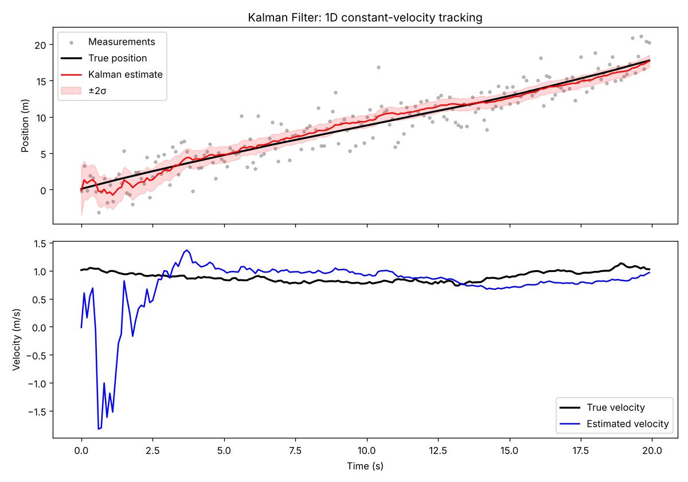

# Kalman Filter Simulation

A basic 1D Kalman filter that tracks a moving object from noisy position
measurements and estimates both its position and velocity.



## Run it

```bash
pip install -r requirements.txt
python kalman_sim.py
```

The script prints the position error (RMSE) of the raw measurements and of the
Kalman estimate, and saves the plot as `kalman_sim.png`.

## How it works

- **State:** `[position, velocity]`
- **Model:** constant velocity with small random accelerations (process noise `Q`)
- **Measurements:** position only, with Gaussian noise (`R`)
- **Loop:** predict → update, once per time step

## Things to try

- Change `meas_std` or `accel_std` and see how the estimate changes.
- Give the filter a wrong `R` on purpose.
- Extend the state to 2D: `[x, y, vx, vy]`.
